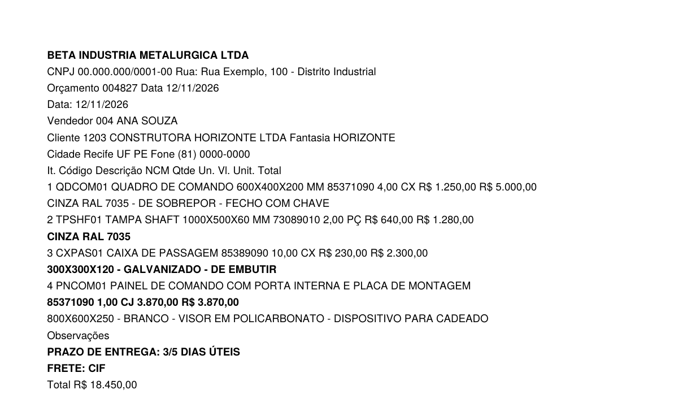
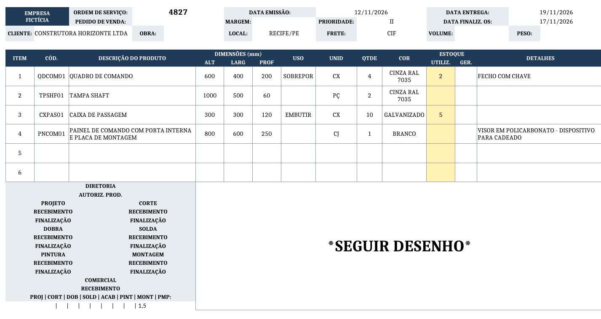
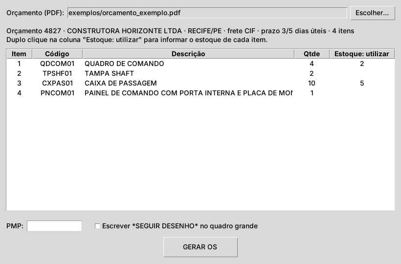

# Gerador de Ordem de Serviço

Lê o **orçamento em PDF** exportado pelo ERP e preenche automaticamente a **planilha de Ordem de Serviço (OS)** que vai para a produção: cliente, local, frete, datas de entrega e finalização e cada item com código, descrição, medidas, uso, unidade, quantidade, cor e detalhes.

> **Origem do projeto:** criei a primeira versão quando trabalhava no apoio comercial de uma indústria metalúrgica. Cada OS era digitada à mão, campo a campo, a partir do orçamento. Aquela versão rodava como executável no Windows (Node.js + PowerShell), porque os computadores não permitiam instalar nada. Este repositório é a **versão de portfólio reescrita em Python**, com as mesmas regras de negócio, um modelo de OS genérico e orçamentos **fictícios**.

| Orçamento (PDF de exemplo) | OS gerada |
|---|---|
|  |  |



## O que ele faz

- **Lê o PDF** reconstruindo as linhas pela posição do texto na página (`pdfplumber`) e interpreta o relatório com expressões regulares.
  - Cabeçalho: número do orçamento, cliente, cidade/UF, frete (CIF/FOB) e prazo de entrega ("3/5 DIAS ÚTEIS").
  - Itens: código, descrição, medidas (`600X400X200 MM`, na descrição ou no complemento), quantidade, unidade, **cor**, **uso** (EMBUTIR/SOBREPOR) e detalhes. Também lê itens com a descrição quebrada em duas linhas.
- **Calcula as datas em dias úteis**, pulando fins de semana, feriados nacionais, a Data Magna de PE, a Sexta-feira Santa (calculada pela data da Páscoa) e as datas extras cadastradas na aba `DADOS` do modelo (férias coletivas, feriados municipais).
  - **FOB:** entrega = emissão + menor prazo.
  - **CIF:** entrega = emissão + maior prazo; finalização da OS = emissão + menor prazo.
  - A célula de entrega fica com a fórmula `WORKDAY`: se alguém digitar os dias úteis em `T2`, a data recalcula sozinha no Excel.
- **Preenche a planilha** com `openpyxl`:
  - com **mais de 6 itens**, insere linhas e copia a formatação e as mesclagens;
  - diminui a fonte de descrições longas para caber na célula;
  - preenche o PMP e, se pedido, escreve `*SEGUIR DESENHO*` no quadro grande.
- **Não sobrescreve OS antigas**: se já existir uma OS com o mesmo número, salva como `(2)`.
- **Funciona de dois jeitos**: pela janela (Tkinter) ou pela linha de comando.

## Tecnologias

Python 3.10+ · pdfplumber · openpyxl · Tkinter · Pytest (18 testes) · reportlab (só para gerar os PDFs de exemplo)

## Como rodar

```bash
pip install -r requirements.txt

# janela
python -m gerador_os

# linha de comando
python -m gerador_os exemplos/orcamento_exemplo.pdf --utilizar 2 "" 5 --pmp 1,5 --seguir-desenho
# -> OS geradas/OS 4827 - CONSTRUTORA HORIZONTE LTDA.xlsx

# testes
python -m pytest
```

## Estrutura

```
gerador_os/
  leitura.py     texto do PDF -> Orcamento (cabeçalho + itens)
  datas.py       Páscoa, feriados, dias úteis e regras FOB/CIF
  planilha.py    plano de preenchimento + escrita no Excel (inserção de linhas, fontes, PMP)
  janela.py      interface Tkinter
  __main__.py    linha de comando
modelo/MODELO_OS.xlsx              modelo genérico de OS (gerado por scripts/criar_modelo.py)
exemplos/                          orçamentos fictícios (gerados por scripts/criar_orcamento_exemplo.py)
tests/test_gerador.py              testes de leitura, datas e planilha
```

O preenchimento é dividido em duas etapas: `montar_plano`, que decide o que vai em cada célula sem tocar em arquivo nenhum, e `preencher_os`, que escreve na planilha. Assim as regras são testadas sem precisar abrir o Excel.

## Autor

**Maickon Santos**: estudante de Análise e Desenvolvimento de Sistemas, em busca de estágio na área de dados.
[LinkedIn](https://www.linkedin.com/in/maickon-santos/) · [GitHub](https://github.com/Maickon0709)
